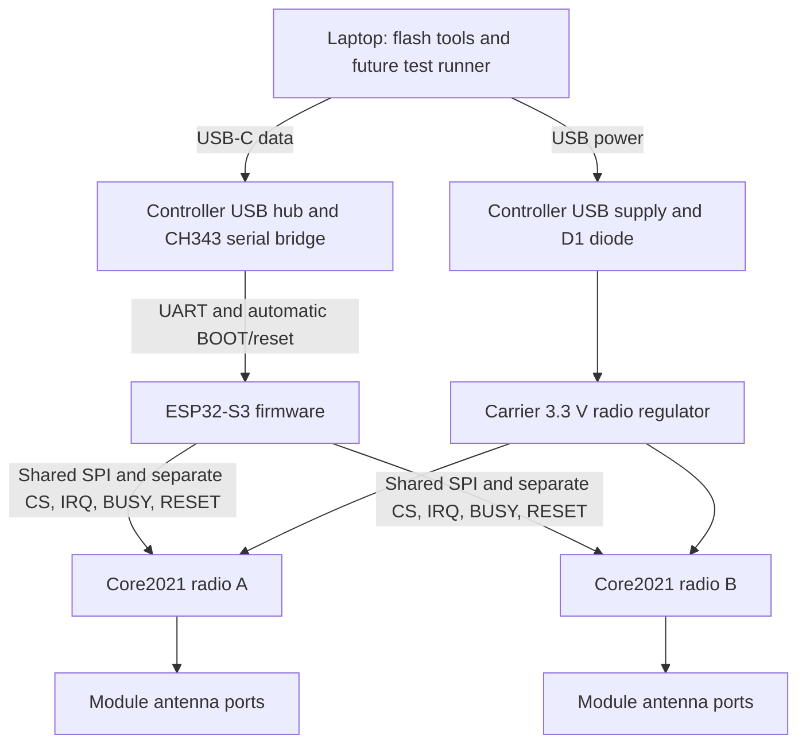
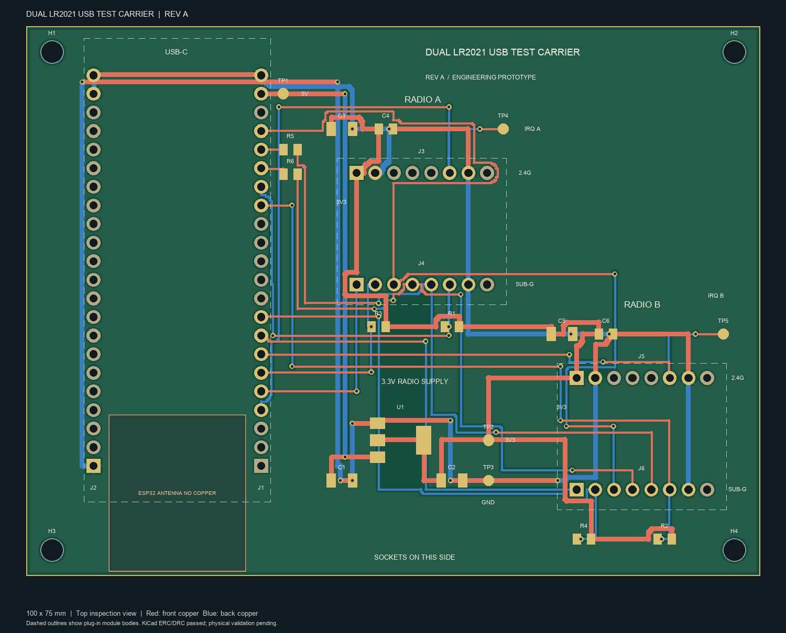

# Dual-LR2021 USB test carrier

A socketed, laptop-powered test platform for two Waveshare Core2021-HF-M radio modules. An ESP32-S3 controller handles the radios. The carrier replaces breadboard jumper wires with PCB traces and female sockets.

The intended workflow is to plug in USB-C, flash firmware from the laptop, command repeatable experiments, and collect machine-readable results. AI coding agents can use the same command-line tools as a person. The firmware and laptop test runner have not been implemented.

## Place in Dual-Band Radio Lab

This is an optional LR2021 development platform. It can help characterize individual LR2021 links and, later, interactions between two radios. Two copies provide two test nodes, each with two radios.

The project's [four-lane architecture](../../docs/dedicated-receiver-bank.md) requires four radios to monitor four persistent network profiles. This carrier holds two radios and can monitor two selected profiles at once. Changing their configuration between experiments does not provide four simultaneous listeners.

The existing [Rev A hardware](../../hardware/README.md) is a separate Pico 2 carrier with E22, Core2021, and E28 daughtercards. This ESP32 carrier uses direct Core2021 sockets. The controllers, GPIO maps, power arrangements, and card interfaces differ. The other daughtercards do not plug into this carrier.

The [individual-radio test plan](../../docs/staged-rollout.md) remains the development sequence. Existing-radio tests do not require this PCB. Adding this archive does not select LR2021 for every lane, approve purchases, or release the existing Rev A hardware for manufacturing.

## System



Either radio can use a supported LoRa or FLRC profile at 915 MHz or 2.4 GHz. Firmware assigns each radio's role. One radio transmits or receives on its selected profile at a time. Nearby operation of both radios requires RF coupling and coexistence measurements.

The carrier routes digital signals and power. RF stays on the modules and their antenna connectors. There is no carrier RF switch, filter, or receiver-protection network. There is no battery input.

See [system responsibilities and intended software](SYSTEM.md) for the control flow, recovery behavior, and unfinished work.

## Hardware and files

The PCB is 100 x 75 mm, two layers, and 1.6 mm thick. Female sockets, the regulator, resistors, and capacitors are soldered to the carrier. The controller and radios plug in afterward.

| Item | Per carrier |
| --- | ---: |
| Waveshare ESP32-S3-DEV-KIT-N8R8-M, SKU 24243 | 1 |
| Waveshare Core2021-HF-M, SKU 34523 | 2 |
| Samtec SSW-122-01-G-S controller sockets | 2 |
| Samtec SSW-108-01-G-S radio sockets | 4 |
| TI TLV1117LV33DCYR radio regulator | 1 |

The [BOM](boards/dual-radio-carrier/bom.csv) includes the remaining parts and separately purchased plug-in modules. Antennas, USB cables, and mounting hardware are not included. Use the exact selected module variants and check their supplied male headers against socket samples.

- [Editable KiCad project](boards/dual-radio-carrier/dual-radio-carrier.kicad_pro), [PCB](boards/dual-radio-carrier/dual-radio-carrier.kicad_pcb), and [schematic](boards/dual-radio-carrier/dual-radio-carrier.kicad_sch).
- [Assembly, GPIO, power, and rebuild instructions](boards/dual-radio-carrier/README.md).
- [GPIO map](boards/dual-radio-carrier/gpio-map.csv) and [radio socket map](boards/dual-radio-carrier/radio-socket-map.csv).
- [Native KiCad check summary](boards/dual-radio-carrier/build/native-summary.json) and [saved-file geometry checks](boards/dual-radio-carrier/build/verification.json).
- [Archived manufacturer evidence](extra/references/) and [historical independent review](extra/reviews/electrical-review.md).
- [Prototype Gerber, drill, BOM, and placement package](mfg/dual-radio-carrier-rev-a-prototype.zip), with [source and output hashes](mfg/dual-radio-carrier-rev-a-prototype/manifest.json).



## Validation and manufacturing status

Native KiCad 10.99.0 checks passed on the saved files: zero ERC violations, zero DRC violations, zero unconnected items, and zero schematic parity issues. The separate saved-file checker also passed. Report hashes identify the exact PCB and schematic in this archive.

No physical board has been fabricated, assembled, or tested. These results do not establish socket fit, USB power capacity, temperature, flashing reliability, or RF performance. The controller's external header current allowance is not specified by its manufacturer. The radio regulator's rating does not establish the upstream USB or diode capacity.

The manufacturing files are an engineering-prototype snapshot for review, not evidence of manufacturing approval or supplier acceptance. No quote, order, manufacturer upload, or purchase has been made. The generic BOM includes plug-in modules, while placement data contains only carrier-mounted parts. A factory assembly handoff must separate those items and confirm part sourcing, through-hole assembly, orientation, and coordinate conventions with the chosen supplier.

The first assembled units need sample-fit, power, thermal, USB recovery, and controlled radio tests. Keep the project's existing manufacturing hold and staged purchase decisions separate from this archive.

## Working with this snapshot

Open the KiCad project inside `boards/dual-radio-carrier/`. The checked board uses the native file format saved by Backplane KiCad 10.99.0. Do not assume older stable KiCad releases can open it.

Run the existing rebuild instructions from this directory:

```sh
cd prototype/dual-lr2021-usb-carrier
```

Generators can overwrite manual CAD edits. Preserve the included final PCB and schematic before regeneration. The saved native CAD files are the uploaded design, and the build reports apply only while their hashes match.
