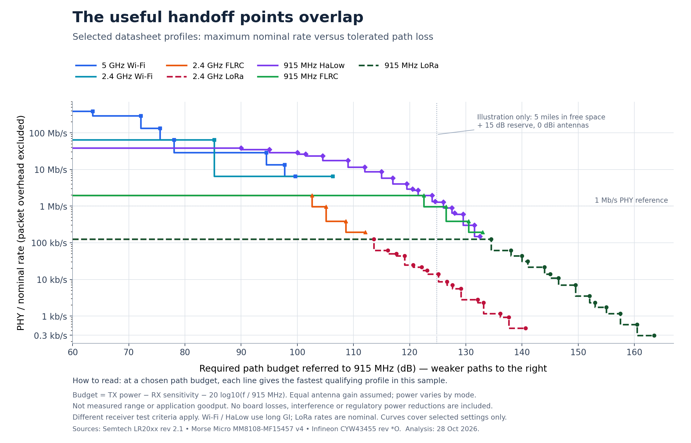

# October 28 multiband profile analysis

This directory preserves the eight files from `radio-profile-analysis.zip` unchanged. It is a reproducible planning analysis, not a hardware test report or the source of the separate Signal website.

## Files

| File                                                               | Purpose                                                             |
| ------------------------------------------------------------------ | ------------------------------------------------------------------- |
| [packet-radio-points.json](packet-radio-points.json)               | Extracted packet-radio settings and source metadata                 |
| [wifi-radio-points.json](wifi-radio-points.json)                   | Extracted Wi-Fi/HaLow settings and source metadata                  |
| [build-radio-comparison.py](build-radio-comparison.py)             | Derivation, figure and export generator                             |
| [radio-profile-data.csv](radio-profile-data.csv)                   | Derived budgets and sampled-frontier flags                          |
| [radio-profile-assumptions.json](radio-profile-assumptions.json)   | Formula, receiver conditions and assumptions                        |
| [radio-profile-summary.json](radio-profile-summary.json)           | Sampled family frontiers                                            |
| [radio-comparison-notes.txt](radio-comparison-notes.txt)           | Interpretation, primary-source URLs and historical candidate policy |
| [radio-range-rate-comparison.png](radio-range-rate-comparison.png) | Saved comparison figure                                             |
| [provenance.json](provenance.json)                                 | Original source and per-file SHA-256/byte count                     |

The main budget proxy is `TX dBm - receiver sensitivity dBm - 20 * log10(frequency MHz / 915)`. It assumes equal antenna gains. Rates are nominal or coding-adjusted and exclude finite-packet/application overhead. Receiver test conditions differ between source tables. Small differences do not establish a controlled performance ranking.

The five-mile reference is illustrative free-space loss plus a chosen reserve. There is no terrain, radio-horizon, interference or coexistence model. This directory provides no hardware approval, region-specific power finding, measured range or delivered-goodput claim.

## Reproduce

With Python 3 and matplotlib available, run:

```sh
python3 build-radio-comparison.py
```

The script reads both source JSON files and regenerates the PNG, CSV, metadata, summary and a ZIP in this directory. Work on a copy if preserving the recovered bytes. Figure byte identity can depend on the Python/matplotlib/font environment; use the manifest to identify the recovered originals.

The original notes recommend a candidate architecture and possible later three-node work. The current continuation order is the [individual-radio test plan](../../../docs/staged-rollout.md); the [project context](../../../docs/project-context.md) explains the distinction. No routing stack or hardware purchase is selected by this import.

[Signal planning workspace](https://signal-radio-lab.drunken.chatgpt.site)


